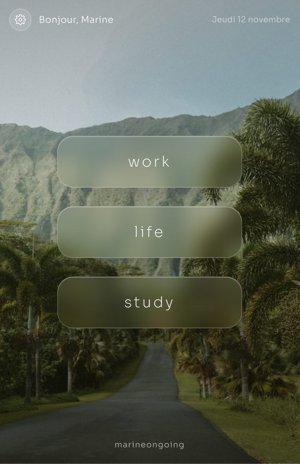
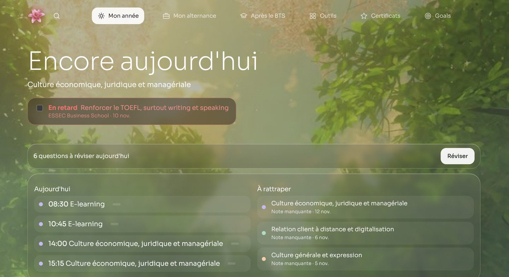
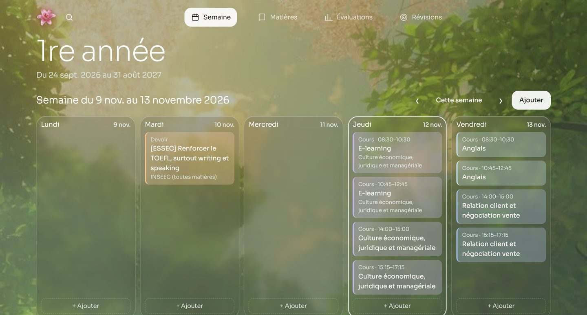
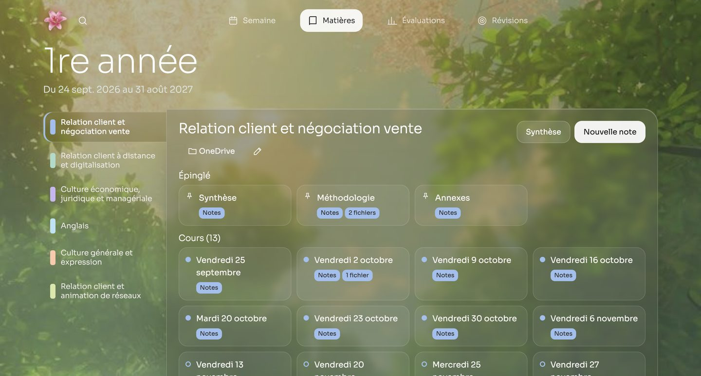
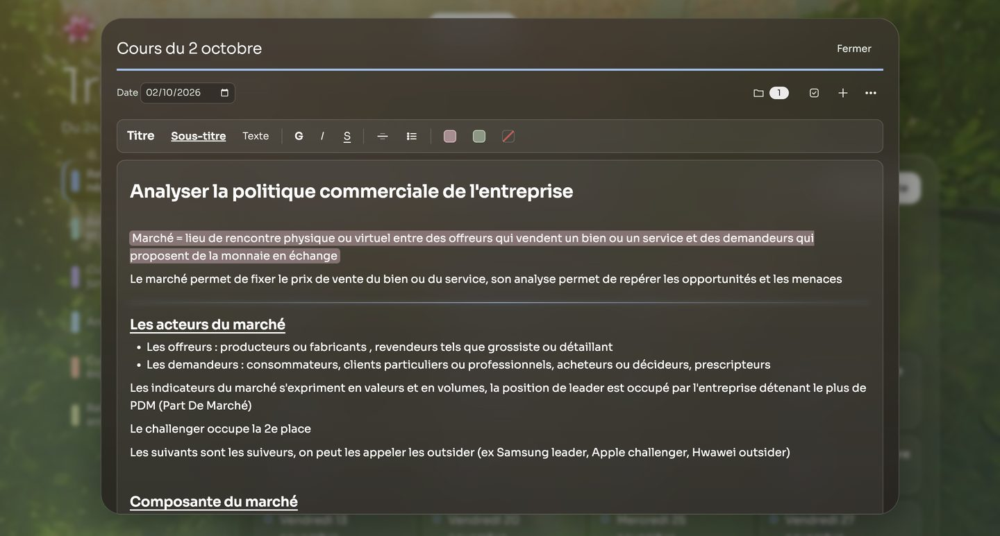
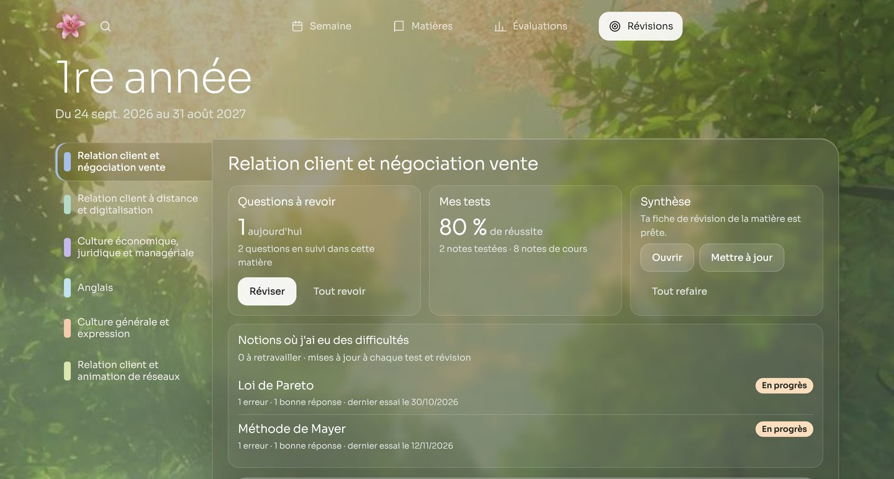
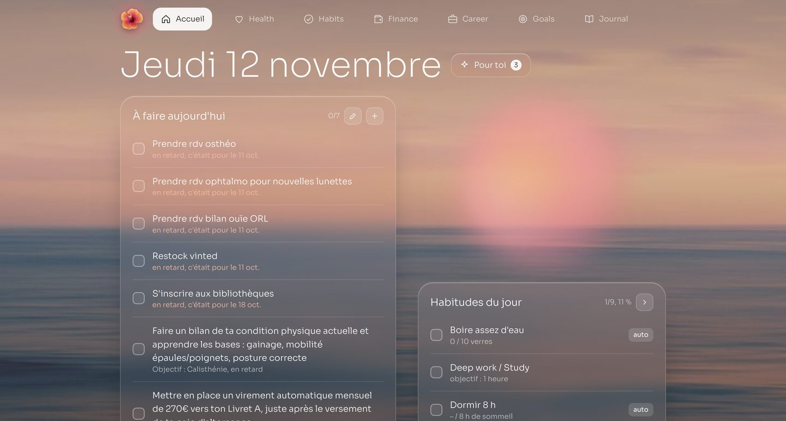
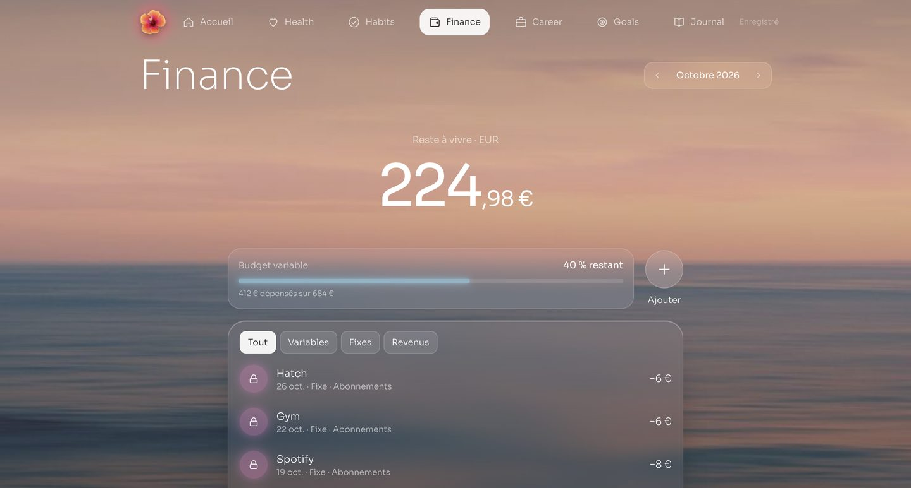

# marineongoing

Mes apps perso pour organiser mes études, ma vie et mon alternance, construites avec Claude Code alors que je ne suis pas développeuse.

Site : https://marineongoing.github.io

## Les apps

- **Study** (`study/`) : la plus grosse partie du projet, et elle est fonctionnelle : je l'utilise tous les jours pour mon BTS NDRC à l'INSEEC. Calendrier des cours, prise de notes par matière, évaluations, alternance et révisions. Claude fait une synthèse de mes notes et me teste avec des quiz de 10 à 30 questions, puis suit les notions où j'ai des difficultés.
- **Life** (`life/`) : encore en phase de test. Humeur du jour, santé (sommeil, pas, eau, sport, cycle), habitudes, finances, carrière, objectifs et journal, avec des recommandations de Claude.
- **Work** : un prototype sous forme d'artefact Claude, pas encore complètement construit.

Une page d'accueil relie les trois, et chaque app s'installe sur l'écran d'accueil de l'iPhone comme une vraie app (PWA).

## Aperçu

### Page d'accueil

  
  

### Study

| Aujourd'hui | Semaine |
|---|---|
|  |  |
| **Matières** | **Note de cours** |
|  |  |
| **Révisions** | |
|  | |

### Life (en test)

| Accueil | Finance |
|---|---|
|  |  |

## Comment c'est fait

- Un fichier HTML par app, sans framework ni build, publié avec GitHub Pages.
- Base de données et connexion avec Supabase. Chaque utilisateur ne voit que ses propres données (règles RLS).
- Les appels à Claude passent par une petite fonction Supabase (`supabase/functions/claude`), pour que la clé API ne soit jamais dans le site.
- Un raccourci iPhone envoie mes données Apple Santé (pas, sommeil, cycle) dans Life.

## Travailler avec Claude Code

Le fichier [`CLAUDE.md`](CLAUDE.md) explique le projet à Claude : comment me parler, où se trouve chaque fichier, les règles à respecter (tester sur iPhone et ordinateur, ne jamais perdre de données, demander mon accord avant de publier) et la charte graphique. C'est ce qui me permet d'avancer avec Claude sans savoir coder.
